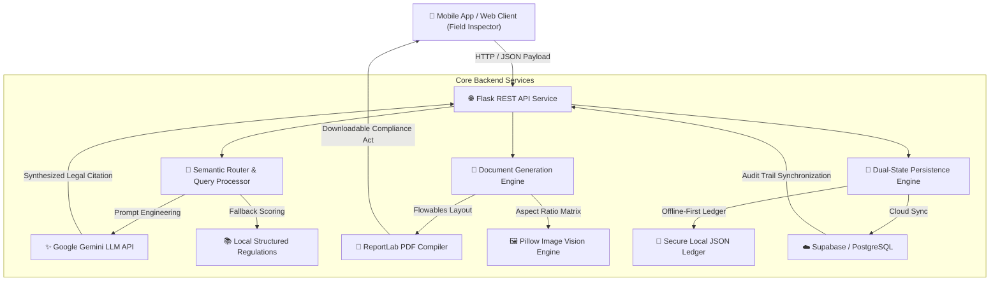

# ⚖️ Legal AI Semantic Assistant
### *Enterprise Generative AI & Automation Backend for Field Compliance & Legal Auditing*

[](https://github.com/Katomoon/legal-ai-semantic-assistant/actions)


An enterprise-grade, offline-first Python backend integrating **Generative AI, Large Language Models (LLMs), and Automated Document Generation** to assist legal auditors, field inspectors, and compliance officers in cross-referencing infractions with official gazettes and regulatory frameworks in real time.

---

## 🏗️ System Architecture



---

## ⚡ Core Engineering Capabilities

1. **Semantic Legal Search & LLM Prompt Engineering:**
   * Ingests natural-language field reports (e.g., *"Merchant discarded cardboard waste on the sidewalk outside authorized hours"*).
   * Matches query semantics against classified municipal ordinances, generating instant legal citations, applicable articles, and monetary sanctions in less than **2.5 seconds**.
   * Integrates Google Gemini API with strict prompt templates and deterministic local fallbacks for zero downtime during network drops.

2. **Automated Document & Evidence Pipeline:**
   * **PDF Generation (`ReportLab`):** Automatically produces official, printable Legal Compliance Acts and Citations adhering to public administrative typography standards.
   * **Photographic Evidence Synthesis (`Pillow`):** Automatically resizes, formats, and watermarks multiple camera snapshots into high-resolution audit collages.

3. **Offline-First Resilience & Cloud Synchronization:**
   * Designed for intermittent connectivity in emerging markets. Saves state to local encrypted ledgers and automatically syncs with **Supabase (PostgreSQL)** when connectivity is restored.

4. **Production Quality Assurance (Unit Testing & CI/CD):**
   * Comprehensive unit testing suite using `pytest` and `pytest-cov`, covering API contract validation, semantic scoring algorithms, and binary document rendering.
   * Automated multi-version Python testing (3.10, 3.11, 3.12) via **GitHub Actions CI**.

---

## 🛠️ Tech Stack & Dependencies

| Layer | Technologies |
| :--- | :--- |
| **Backend & REST APIs** | Python 3.10+, Flask, Pydantic, Gunicorn |
| **AI & LLM Services** | Google Gemini API (LLM & Vision OCR), Custom Prompt Engineering |
| **Document Processing** | ReportLab (Vector PDF layout), Pillow (PIL - Image Synthesis) |
| **Cloud & Database** | PostgreSQL, Supabase Cloud Database, RESTful sync |
| **Testing & CI/CD** | Pytest, Pytest-Cov, Flake8, GitHub Actions |

---

## 🚀 API Specification & Endpoints

### 1. Health Check
* **`GET /health`**
```json
{
  "status": "online",
  "service": "Legal AI Semantic Assistant",
  "environment": "production",
  "regulations_indexed": 5
}
```

### 2. Semantic Search on Regulations
* **`POST /api/v1/search`**
* **Request Body:**
```json
{
  "query": "Comercio sacando desechos fuera del horario",
  "top_k": 2
}
```
* **Response:**
```json
{
  "query": "Comercio sacando desechos fuera del horario",
  "confidence": 0.85,
  "matches": [
    {
      "id": "Art_16",
      "categoria": "Horarios de Recolección",
      "titulo": "Horario reglamentario de disposición de desechos",
      "sancion": "Multa de 30 veces MMVBCV."
    }
  ],
  "ai_summary": "Presunta contravención tipificada en el Art_16 (Horario reglamentario). Consecuencia jurídica aplicable: Multa de 30 veces MMVBCV."
}
```

### 3. Generate Official PDF Act
* **`POST /api/v1/generate-acta`**
* **Request Body:** Inspection metadata (`id`, `sector`, `inspector`, `articulo_infringido`, `sancion_propuesta`).
* **Response:** Binary PDF stream (`Content-Type: application/pdf`).

---

## 💻 Local Setup & Development

### Prerequisites
* Python 3.10 or higher
* Git

### Installation
```bash
# Clone the repository
git clone https://github.com/Katomoon/legal-ai-semantic-assistant.git
cd legal-ai-semantic-assistant

# Create and activate virtual environment
python -m venv venv
# On Windows:
venv\Scripts\activate
# On Linux/macOS:
source venv/bin/activate

# Install dependencies
pip install -r requirements.txt

# Configure environment variables
cp .env.example .env
```

### Running Unit Tests
```bash
# Execute test suite with coverage report
pytest tests/ -v --cov=src --cov-report=term-missing
```

### Starting the Local Development Server
```bash
python -m src.app
# Server will listen on http://127.0.0.1:5000
```

---

## 🧪 Test Suite Coverage
* `tests/test_api.py`: Validates endpoint contracts, HTTP status codes, and input validation.
* `tests/test_ai_service.py`: Tests indexing, token overlap heuristics, and LLM query pipelines.
* `tests/test_document_service.py`: Tests ReportLab PDF compilation and Pillow collage generation.

---

## 👤 Author
**Ángel Daniel Giménez Arcia**  
*Junior AI & Python Developer | UNESR Administration in Computer Science*  
* LinkedIn: [linkedin.com/in/angeldanielgimenez](https://linkedin.com)
* GitHub: [@Katomoon](https://github.com/Katomoon)

---

## 📄 License
This project is open-source and available under the [MIT License](LICENSE).
