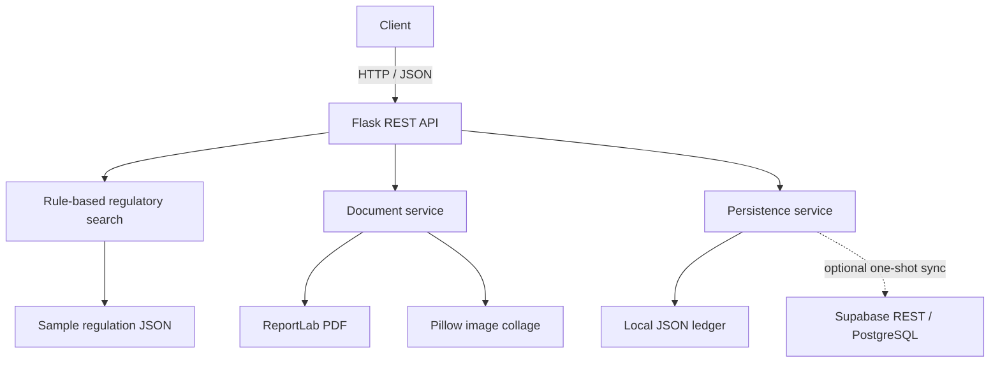

# FiscalIA — Legal Information & Document Automation Backend

[](https://github.com/Katomoon/legal-ai-semantic-assistant/actions/workflows/ci.yml)


FiscalIA is a personal Python/Flask project for searching a small structured sample of legal/regulatory records and generating demonstration PDF reports and image collages. It includes REST endpoints, local JSON persistence, optional Supabase REST synchronization, and pytest tests.

> **Important:** This is a portfolio/demo application, not an official government system or a source of legal advice. The bundled regulation records are sample data. Their authenticity, current validity, citations, and penalty amounts have not been independently verified. Generated PDFs are clearly marked as demonstrations and have no official or legal validity.

## Features

- **Rule-based regulatory search:** token overlap and keyword/category scoring against bundled JSON records. This is not semantic vector search and does not use AI, machine learning, embeddings, or an LLM.
- **Document generation:** PDF demonstration reports using ReportLab.
- **Image processing:** collage generation and basic image normalization using Pillow. There is no OCR or automatic plate/document recognition.
- **Persistence:** local JSON ledger with an optional one-attempt Supabase REST insert. Failed cloud requests are reported as not synced; there is no background retry queue.
- **Testing:** pytest coverage of API behavior, rule-based matching, persistence, PDF generation, and collage generation.
- **CI:** GitHub Actions runs lint checks and tests across supported Python versions.

## Architecture



## Technology stack

| Area | Tools |
|---|---|
| Backend | Python 3.10+, Flask |
| API | JSON over HTTP / REST-style endpoints |
| Search | Python regular expressions, token overlap, weighted keyword rules |
| Documents | ReportLab |
| Images | Pillow |
| Persistence | JSON files, optional Supabase REST API |
| Testing / CI | pytest, pytest-cov, Flake8, GitHub Actions |

## API

### Health check

`GET /health`

Returns service status and the number of sample regulation records loaded.

### Search sample regulations

`POST /api/v1/search`

Request:

```json
{
  "query": "Comercio sacando basura fuera del horario",
  "top_k": 2
}
```

The response includes `matches`, `summary`, and `relevance_score`. For backward compatibility, `ai_summary` and `confidence` are still returned as deprecated aliases. The score is a heuristic relevance indicator, not a calibrated probability or AI confidence score. `top_k` must be an integer from 1 to 10.

### Create and list reports

- `POST /api/v1/reports`: saves a report to the local JSON ledger and optionally attempts one Supabase insert.
- `GET /api/v1/reports`: lists locally stored reports.

### Generate a demonstration PDF

`POST /api/v1/generate-acta`

Generates a PDF from supplied report fields. The output is prominently marked **DEMO — NO OFFICIAL OR LEGAL VALIDITY**. The identifier used for the output filename is sanitized.

### OCR

`POST /api/v1/ocr-plate` currently returns HTTP `501 Not Implemented`. The route is retained to provide an explicit response to older clients, but OCR is not implemented and no image data is interpreted.

## Local setup

Requirements: Python 3.10+ and Git.

```bash
git clone https://github.com/Katomoon/legal-ai-semantic-assistant.git
cd legal-ai-semantic-assistant

python -m venv venv

# Windows PowerShell / CMD
venv\Scripts\activate

# Linux / macOS
source venv/bin/activate

python -m pip install --upgrade pip
pip install -r requirements.txt
```

Optional Supabase configuration: copy `.env.example` to `.env` and set `SUPABASE_URL` and `SUPABASE_KEY`. Keep real credentials out of Git. The application stores reports locally even if cloud sync is not configured or fails.

Run tests:

```bash
pytest tests/ -v --cov=src --cov-report=term-missing
```

Run the development server:

```bash
python -m src.app
```

The default local address is `http://127.0.0.1:5000`. Do not expose the development server publicly without adding authentication, deployment hardening, and appropriate access controls.

## Project structure

```text
src/
  app.py
  config.py
  services/
    ai_service.py          # Legacy filename/class; implementation is rule-based search
    database_service.py
    document_service.py
tests/
data/
  sample_regulations.json
.github/workflows/ci.yml
```

## Data and limitations

- `data/sample_regulations.json` is a small demonstration dataset, not an authenticated legal source.
- Search results are keyword/heuristic matches and must be checked against current official publications by a qualified person.
- OCR, LLM integration, embeddings, and machine-learning features are not implemented.
- Supabase synchronization is a single HTTP attempt; there is no durable queue or automatic retry mechanism.
- The API currently has no authentication or authorization and is intended for local demonstration/testing, not production deployment.

## Author

**Ángel Daniel Giménez Arcia**  
Junior Python Developer  
Administration in Informatics — UNESR (undergraduate studies started 2022; currently paused, degree not completed)  
GitHub: [@Katomoon](https://github.com/Katomoon)  
Email: [angelgimenez28@gmail.com](mailto:angelgimenez28@gmail.com)

## License

This project is available under the MIT License. See [LICENSE](LICENSE).
